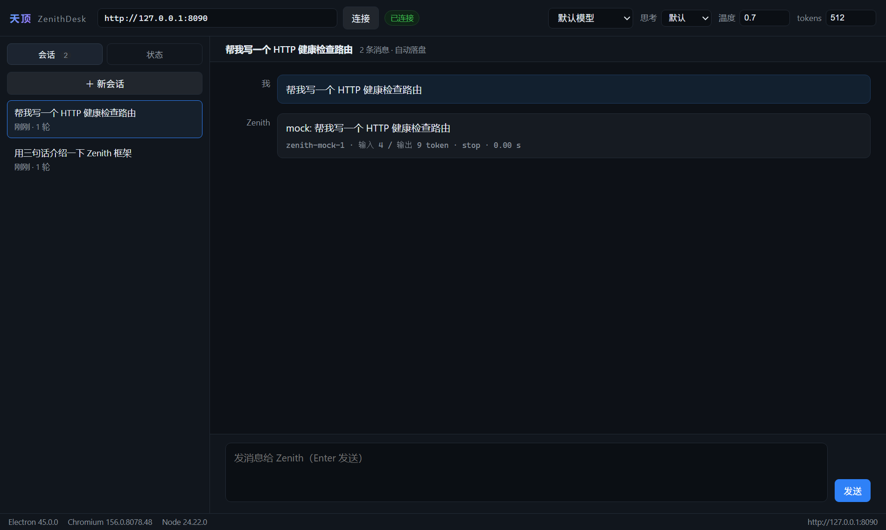
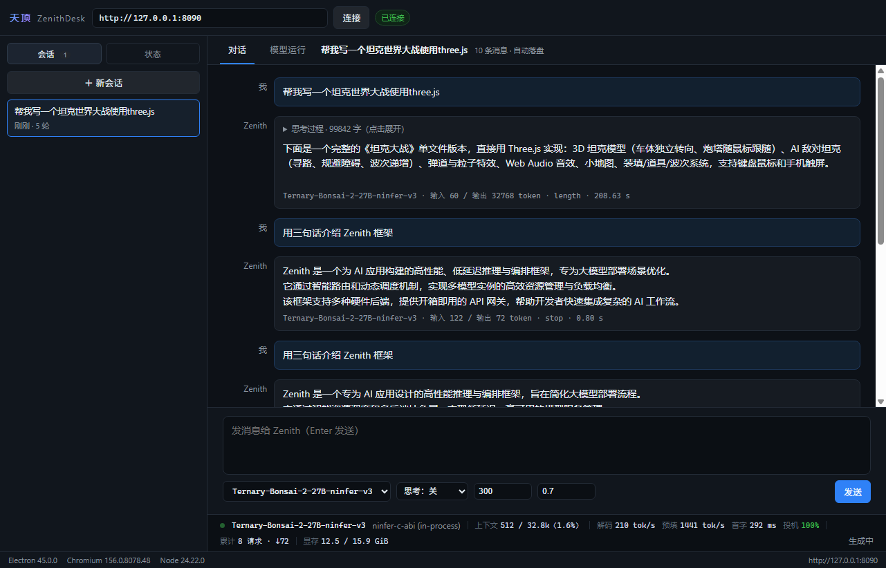

# ZenithDesk

[](https://github.com/Crush2680933378/ZenithDesk/actions/workflows/ci.yml)
[](https://github.com/Crush2680933378/ZenithDesk/actions/workflows/release.yml)
[]()
[]()

> Zenith 的桌面控制台：**React 19 + Vite 8 + Electron 45**。
> 连上 Zenith 网关后即可多轮对话（SSE 流式），左侧实时显示引擎状态、吞吐与累计用量。

## ⬇️ 下载（免安装）

到 [Releases](https://github.com/Crush2680933378/ZenithDesk/releases/latest) 直接下载：

| 文件 | 说明 |
|---|---|
| **`ZenithDesk-<ver>-win-x64-portable.exe`** | **免安装单文件**：下载双击即运行（每次启动自解压到临时目录，不在系统里留东西） |
| `ZenithDesk-<ver>-win-x64-setup.exe` | 安装包：装到本机，创建开始菜单 / 桌面快捷方式 |
| `ZenithDesk-<ver>-linux-x86_64.AppImage` | Linux：`chmod +x` 后直接运行 |

> 首次启动若提示「连接失败」是正常的——需要先起 Zenith 网关
> （[`examples/07_ai_gateway`](../Zenith/examples/07_ai_gateway)，默认 `http://127.0.0.1:8090`）。





## 它连的是什么

配套后端是 Zenith 仓库里的 [`examples/07_ai_gateway`](../Zenith/examples/07_ai_gateway)：
把 AI 推理插件挂成 OpenAI 兼容网关。契约（全部为 OpenAI 形状 + 两个 Zenith 扩展端点）：

| 端点 | 用途 |
|---|---|
| `POST /v1/chat/completions` | 对话；`stream: true` 走 SSE（`data: {...}` / `data: [DONE]`） |
| `GET /v1/models` | 模型列表（`data[].id`） |
| `GET /zenith/ai/status` | 网关 + 引擎运行态（backend / models / engine / counters） |
| `GET /metrics` | Prometheus 文本（本界面解析出 tps、token、请求数） |
| `GET /healthz` | 存活探针 |

扩展字段：请求体里 `thinking: -1 | 0 | 1` 控制思考模式（Zenith 后端会透传给引擎）。

## 快速开始

```powershell
# 1) 先起 Zenith 网关（另一仓库）：默认 mock 后端，无需模型
cd ..\Zenith
cmake --build build\m9 --target ai_gateway
.\build\m9\bin\ai_gateway.exe 8090

# 2) 再起桌面端
cd ..\ZenithDesk
npm install
npm start            # = vite build + electron .
```

开发模式（改 UI 热更新）：`npm run dev` 后另开一个终端
`$env:VITE_DEV_SERVER_URL='http://localhost:5173'; npx electron .`。

> 本机注意：如果环境里存在 `ELECTRON_RUN_AS_NODE=1`，Electron 会退化成纯 Node，
> 启动前需要 `$env:ELECTRON_RUN_AS_NODE = $null`。

## 开发（怎么看到效果）

**一条命令**：起 Vite 开发服务器 + 开 Electron 窗口（自动指向开发服务器）

```powershell
npm run dev:app
```

- 改 `src/**`（界面）→ **即时热更新**，窗口不用重开
- 改 `electron/**`（主进程）→ 重启 `npm run dev:app`（主进程不支持 HMR）
- 打开 DevTools：窗口内按 <kbd>F12</kbd> 或 <kbd>Ctrl</kbd>+<kbd>Shift</kbd>+<kbd>I</kbd>
- 退出：终端 `Ctrl+C`（脚本会把 Vite 一并结束，不留孤儿进程）

其他入口：

| 命令 | 用途 |
|---|---|
| `npm run dev:app` | **开发首选**：Vite + Electron，带热更新 |
| `npm start` | 先 `vite build` 再开窗口（最接近发布版行为，无 HMR） |
| `npm run dev` | 只起 Vite；浏览器直接打开会提示"需要 Electron 外壳"（没有 preload 桥） |
| `npm run smoke` | 构建 + 无头截图到 `screenshot.png`（自动化验收用） |
| `npm run dist:win` | 打 NSIS 安装包 + portable 单文件 |

前提：网关在跑 —— `..\Zenith\build\m9\bin\ai_gateway.exe 8090`；没起也能开窗口，只是显示「连接失败」。

> 手动 `npx electron .` 启动时注意：本机若有 `ELECTRON_RUN_AS_NODE` 环境变量，
> Electron 会退化成纯 Node（窗口不出现且不报错），需先 `$env:ELECTRON_RUN_AS_NODE = $null`。
> `npm run dev:app` 已自动清掉。

## 目录结构

```
ZenithDesk/
├─ electron/
│  ├─ main.cjs        主进程：窗口、IPC、HTTP/SSE 客户端、设置持久化、冒烟截图
│  └─ preload.cjs     contextBridge 暴露的唯一通道（window.zenith）
├─ src/
│  ├─ App.jsx         顶栏（地址/模型/思考/温度/tokens）+ 布局 + 流式装配
│  ├─ components/
│  │  ├─ ChatPanel.jsx    消息流、思考过程折叠、输入框
│  │  ├─ SessionList.jsx  会话列表（新建/切换/双击重命名/删除）
│  │  └─ StatusPanel.jsx  引擎状态 / 吞吐 / 累计 / HTTP / 模型
│  ├─ metrics.js      Prometheus 文本解析
│  └─ styles.css      深色主题（无 UI 依赖）
├─ index.html         CSP: default-src 'self'
├─ vite.config.mjs    base:'./'（Electron 走 file://）
└─ screenshot*.png    冒烟产物
```

## 多会话与历史落盘

左侧「会话 / 状态」两个页签；会话列表支持**新建、切换、双击重命名、悬停删除**，
每条气泡自动随流式结束写入历史，重启后恢复到上次的会话与滚动位置。

| 设计点 | 做法 |
|---|---|
| 存储位置 | `%APPDATA%/zenithdesk/sessions.json`（与设置文件同目录） |
| 写入方式 | **临时文件 + rename 原子替换**：崩溃/断电时要么旧版本要么新版本，不会留下半截 JSON |
| 写入时机 | 防抖 500 ms + 内容快照比对（`JSON.stringify` 相等就不写），流式过程中不写 |
| 只存稳定字段 | `role / content / reasoning / meta / error`；`pending` 等瞬时态丢弃 |
| 自动标题 | 会话标题为「新会话」且出现首条用户消息时，取前 24 字作标题 |
| 归谁管 | **主进程**持有存储与 CRUD（`sessions:state/get/create/activate/rename/save/delete`），渲染进程只有 `window.zenith.sessions*` |

> 存储用单文件而非每会话一文件：历史体量小（纯文本），单文件便于原子替换；
> 真到几万条消息时再拆分为目录 + 索引即可，接口不用改。

## 为什么 HTTP 都由主进程发

渲染进程从 `file://` 加载，`Origin` 是 `null`，直连网关会被 CORS 拦。
所以：**主进程 fetch** → 解析 SSE → 通过 IPC 逐片推给界面（`chat:chunk`）。
好处是顺带能拿到完整状态码/错误体，页面里也不出现 token 与跨域配置。

`contextIsolation: true` + `nodeIntegration: false`，渲染进程只能用 `window.zenith`
暴露的那几个方法。

## 打包（electron-builder）

```powershell
npm run dist:win     # → release/ZenithDesk-<ver>-win-x64-setup.exe（NSIS 安装包）`n#                    → release/ZenithDesk-<ver>-win-x64-portable.exe（免安装单文件）
npm run dist:linux   # → release/ZenithDesk-<ver>-linux-x64.AppImage
npm run pack         # 只解包不打包（release/win-unpacked/），排查产物问题用
```

配置在 `package.json` 的 `build` 字段：NSIS 非一键安装、可选安装目录、`release/` 输出、
图标取 `build/icon.png`（512×512，electron-builder 自动转 ICO）。

> **国内网络**：electron-builder 的 NSIS/winCodeSign 工具链从 `github.com` 拉取。
> 若被墙，二选一：设代理 `$env:HTTPS_PROXY='http://127.0.0.1:7897'`，
> 或用镜像 `$env:ELECTRON_BUILDER_BINARIES_MIRROR='https://npmmirror.com/mirrors/electron-builder-binaries/'`。
> GitHub Actions 的 runner 在境外，无需这两个变量。

### 发版流程

```powershell
git tag v0.1.0
git push origin v0.1.0     # 触发 .github/workflows/release.yml
```

`release.yml` 在 Windows 与 Linux 两端分别打包，并上传到 **GitHub Release（草稿）**；
到 Releases 页面确认产物后点 Publish 即可。产物同时作为 Actions artifact 留存 90 天。

## CI

| job | 内容 |
|---|---|
| `build (ubuntu-latest)` | `npm ci` → `vite build` → **xvfb 跑 Electron 冒烟截图**（产物上传）→ `electron-builder --dir` 自检 |
| `build (windows-latest)` | `npm ci` → `vite build` → `electron-builder --dir` 自检 |

Linux 侧用 `xvfb-run` 起虚拟屏跑 `--smoke`，把界面截图作为 artifact 留存——这样"界面白屏 /
渲染报错"这类问题能在 PR 阶段被看到，而不必人工开窗。

## 冒烟 / 截图（无人值守）

```powershell
npm run build
node_modules\electron\dist\electron.exe . --smoke            # 空态 → screenshot.png
node_modules\electron\dist\electron.exe . --smoke --smoke-demo   # 真发一条 → screenshot-chat.png
node_modules\electron\dist\electron.exe . --smoke --smoke-demo --demo-new --demo-text="问题"  # 新会话 → screenshot-sessions.png
```

`--smoke-demo` 会通过渲染进程里的 `window.__zenithDemo(text)` 钩子驱动一次真实发送，
等流式结束后 `capturePage()` 存图并退出（超时 15 s 强退）。

## 已知限制

- **mock 后端没有引擎 timings**：网关默认 mock 时「预填/解码/TTFT」显示 `—`，
  换成 `ai_llama` / `ai_ninfer` 等真后端才有值。
- **思考开关**是 Zenith 的扩展字段，标准 OpenAI 客户端不认识，不影响本界面。
- 已配 electron-builder（NSIS + AppImage），但**未做自动更新**（`electron-updater`）。
- 历史是**明文**存盘的（`sessions.json`），不含加密；多人共用一台机器时注意。
